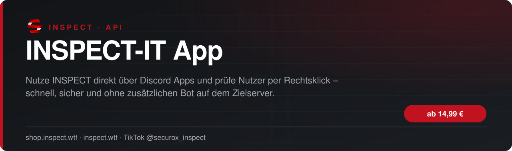
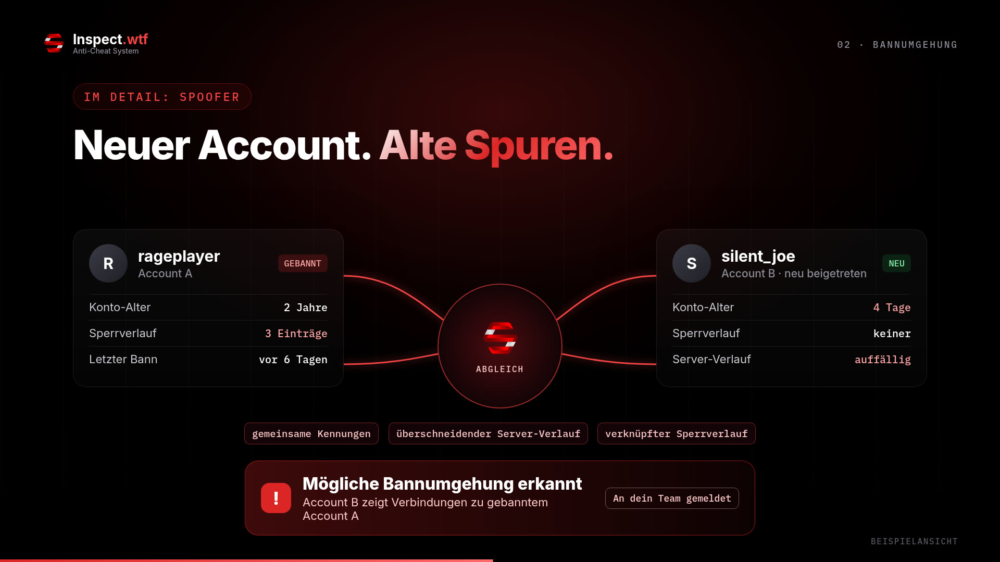

<!-- inspect-showcase: automatisch erzeugt, Änderungen bitte im Shop vornehmen -->

  
  
  
  

<h3>Nutze INSPECT direkt über Discord Apps und prüfe Nutzer per Rechtsklick – schnell, sicher und ohne zusätzlichen Bot auf dem Zielserver.</h3>

  
  
  
  

---

## Überblick

Mit der INSPECT Inspect-It App erhältst du zeitlich begrenzten Zugriff auf die INSPECT-Scan-Funktion direkt über Discord. Nach bestätigter Zahlung wird deinem im Shop hinterlegten Discord-Account automatisch die erforderliche Berechtigungsrolle zugewiesen. Solange deine Lizenz aktiv ist, kannst du Nutzer über Rechtsklick → Apps → inspectit prüfen. Nach Ablauf wird die Shop-Berechtigungsrolle automatisch wieder entfernt, sofern keine Verlängerung oder manuelle Freigabe besteht.

## Funktionen

- ✅ INSPECT-Scan direkt über Discord Apps
- ✅ Nutzerprüfung per Rechtsklick → Apps → inspectit
- ✅ Keine zusätzliche Bot-Installation auf dem Zielserver erforderlich
- ✅ Automatische Discord-Rollenfreischaltung nach bestätigter Zahlung
- ✅ Automatische Verlängerung der Berechtigungsdauer bei erneutem Kauf
- ✅ Automatische Rollenentfernung nach Ablauf der Lizenz
- ✅ Bestehende INSPECT-Prüfergebnisse und Datenbankabfragen
- ✅ Zugriff über den im Shop hinterlegten Discord-Account
- ✅ Weitere Informationen auf Dem Offizellen Inspect Discord

## Einblicke

<table>
  <tr>
    <td width="50%"></td>
  </tr>
</table>

## Video

Neue Clips, Updates und Vorschauen gibt es regelmäßig auf TikTok: **[@securox_inspect](https://www.tiktok.com/@securox_inspect)**

## Preise

| Laufzeit | Preis |
|:--|--:|
| 1 Monat | **14,99 €** |
| 3 Monate | **42,72 €** |
| 6 Monate | **80,95 €** |
| 12 Monate | **152,90 €** |

<a href="https://shop.inspect.wtf/produkt/inspect-it-app"><b>➜ Zum Produkt im Shop</b></a>

## Kauf, Einrichtung & Support

1. **Kaufen** im offiziellen Shop: [shop.inspect.wtf](https://shop.inspect.wtf) – PayPal und Karte, Rechnung automatisch per E-Mail.
2. **Freischaltung & Download** findest du sofort nach der Zahlung in deinem Kundenkonto.
3. **Hilfe** bekommst du im [INSPECT Discord](https://discord.gg/inspect) – schnell, persönlich und auf Deutsch.

| | |
|:--|:--|
| 🛒 Shop | [shop.inspect.wtf](https://shop.inspect.wtf) |
| 🌐 Website | [inspect.wtf](https://inspect.wtf) |
| 💬 Discord | [discord.gg/inspect](https://discord.gg/inspect) |
| 🎬 TikTok | [@securox_inspect](https://www.tiktok.com/@securox_inspect) |
| ✉️ E-Mail | [info@inspect.wtf](mailto:info@inspect.wtf) |

---

<b>INSPECT</b> · Offizielle Produktpräsentation. Dieses Repository enthält keinen Quellcode und keine Produktdateien. 
Kauf und Lizenzen ausschließlich über <a href="https://shop.inspect.wtf">shop.inspect.wtf</a> · Inhalte werden automatisch aus dem Shop aktualisiert.

